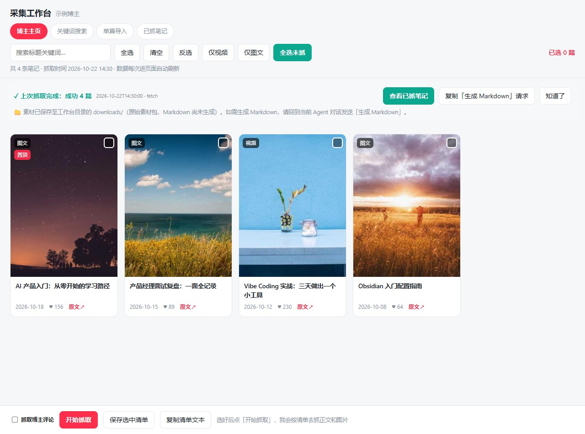

<div align="center">

# 📕 xhs-curator — Xiaohongshu → Obsidian, on demand

**<a href="README.md">简体中文</a> | English**

</div>

---

## 📖 Introduction

**Pick-and-save Xiaohongshu notes into Obsidian — batch or single**: the note body, the **substance inside images**, and the creator's own comment supplements, captured in one pass. Two ways in —

1. **Whole profile**: the creator's profile or your search results laid out as cards — click what you want to keep;
2. **Single note**: paste a share link and fetch directly — no login required.

Unlike "paste a link, get a note" or "bulk-download everything" tools, it goes deeper in three places: **per-image judgment** — content-heavy images become searchable text (no image/text duplication), screenshots and photos are kept as-is; **comments filtered twice** — only the creator's own replies survive, small talk is dropped; **headings restored** — visual headings like `01｜xxx` become real `###` headings in the Obsidian outline. Everything lands in your vault in Obsidian-native format, ready to read.

**Who it's for**: people who treat Xiaohongshu as an information source and want to keep it in a knowledge base (job-hunting notes, industry experience, tutorials, competitor research).

## 🎁 What you get

A real export sample (content omitted):

```markdown
---
title: "Talking about projects is also a kind of progressive disclosure"
author: "some creator"
published: 2026-08-06          # original publish date
created: 2026-10-15            # import date
description: "When preparing for interviews I suddenly realised…"
source: "https://www.xiaohongshu.com/explore/…"    # link back to the original note
tags:
  - xiaohongshu
  - interview
  - progressive-disclosure   # #hashtags in the body are moved here
类型: 图文
点赞: "465"
---

## 正文

…full body text, with #hashtag[话题]# markers and @mentions stripped out…

### 01｜One of the section headings found in the body   ← visual headings restored as real headings
（lines that look like headings in the app become `###` headings — they show up in the Obsidian outline）

## 图片与文字转录

![[note-title--img_01.jpg]]

![[note-title--img_02.jpg]]
（content-heavy image: text transcribed verbatim — **the image itself is not embedded**, so text and picture never repeat）
（screenshots, selfies, scenery and mood shots: the image is kept as-is）

## 博主的评论                     ← always last in the note, small talk filtered out

> 03｜… (the body said "running out of space, see comments" —
> the full version from the author's comment is captured too;
> one-liners like "haha" or "miss you" are dropped automatically)
```

**What you end up with**: the body text, the text inside the images, and the author's comment replies — all three. No emoji in titles, no hashtag noise in the body; ready to read.

## 📸 Screenshot



The workbench is a local web page with four persistent tabs: **Creator profile / Keyword search / Single note / Fetched notes**.

Browse notes as cards with select-all / invert / video-only / image-only / keyword filter; fetched notes are automatically badged 「已抓过」. **Click a card to select it**, **click the title or "原文↗" to preview the note in an embedded detail view** (press `Esc` or the "← 返回列表" button to come back — your selection is preserved).

**Single note tab**: paste a share link (or a whole share text block) and hand it to the AI — it resolves and fetches in one step, with already-fetched notes detected automatically.

**Long-task progress & control (shipped 2026-10-22)**: during batch fetching the workbench shows a live structured progress bar (processed N/M, success/fail/skip, current note). **Stopping is cooperative** — hit "Stop" and the fetcher finishes the current note, keeps everything already saved, and records the task as "stopped" rather than "failed". A persistent result card stays on the page afterwards: the success card offers open-save-location / view-fetched-notes / copy a "generate Markdown" request; partial cards expand failure reasons with a **retry-failed-only** action; new tabs never show stale cards from other sessions.

## ✨ Features

**Discovery & collection**

- ✅ Curation workbench with four persistent tabs: creator profile / keyword search / single note / fetched notes
- ✅ Fetch a creator's full note list (profile URL / share short link / user ID)
- ✅ Search by keyword right inside the page — no extra terminal
- ✅ Visual selection: select-all / invert / video-only / image-only / keyword filter / **select-unfetched**
- ✅ Fetched notes are badged automatically, reconciled with local download records
- ✅ In-window note preview; selection auto-saved
- ✅ One-click fetch from the page: the script runs in the background with live logs, badges refresh when done
- ✅ Fetch body text, original images; videos prefer platform subtitles (only generated for some videos), falling back to key frames
- ✅ Author-only comments (including replies and pinned ones)
- ✅ Resumable fetching (offset / count)

**Processing & export**

- ✅ Three-tier OCR classification (transcribe key text / keep screenshot essentials / photos only)
- ✅ **Per-image smart handling**: content-heavy images become searchable text (image dropped to avoid duplication), screenshots and photos kept as-is
- ✅ Body headings restored as real `###` headings: lines like `01｜xxx` or `第一层是主干` become outline-navigable, so long notes read much smoother
- ✅ Author comments auto-filtered: substantive supplements stay, small talk never enters the vault
- ✅ Body cleanup: hashtags → frontmatter tags, mentions removed
- ✅ Emoji stripped from titles, safe filenames
- ✅ Obsidian-native export: frontmatter + `![[wikilink]]` attachment folders

## 🆚 How it differs

| Project (stars) | Form | Input | Browse before picking | Text in images | Comment handling | Output |
|---|---|---|---|---|---|---|
| **xhs-curator** | Visual workbench + scripts | Creator profile / keyword / single note | ✅ pick by clicking | ✅ **per-image decision**: content-heavy → text, decorations kept | ✅ **author-only + small-talk filter** | Obsidian vault |
| MediaCrawler (30k) | CLI crawler | Keyword / creator page | ❌ | ❌ images only | ⚠️ all comments, unfiltered | JSON / database |
| XHS-Downloader (11.7k) | CLI / userscript | Note links, account lists | ❌ bulk download | ❌ images only | ❌ none | local files |
| xhs-claude-skills (423) | Claude Code plugin | Single share link | ❌ | ✅ multimodal OCR (two-way split) | ❌ none | condensed Obsidian notes |
| xiaohongshu-importer (140) | Obsidian plugin | Single share link (batch) | ❌ link in, note out | ❌ images only | ❌ none | Obsidian |
| feedgrab | CLI | Single URL (multi-platform) | ❌ | ❌ | ❌ | generic Markdown |

### Three things most similar tools don't do

After reading the source and docs of these fellow quality projects, three gaps stand out:

1. **Text inside images — read it, then decide per image**. Peers generally "download the image, never read it" (MediaCrawler, XHS-Downloader and the Obsidian plugins ship no OCR at all). We read every image, then judge **one by one**: content-heavy images become searchable text and the image itself is dropped (no duplication), while screenshots, selfies and scenery shots are kept (the picture *is* the information). The only peer on the same track, xhs-claude-skills, stops at a two-way text/decoration split.
2. **Comments, filtered twice**. Peers either skip comments or grab them all (MediaCrawler pulls the full comment stream). We first filter by author (only the creator's own replies — that's where "see comments for details" content lives), then by value: substantive supplements stay, one-liners like "haha" or "miss you" are dropped.
3. **Browse before picking**. Peers are "paste a link, get a note" or "bulk-download the list". We lay the creator's profile out as cards first — you pick what's worth keeping, and can even open the original note right inside the workbench.

## 🔗 Supported inputs

| What you have | Command | Output |
|---|---|---|
| Creator profile URL / short link / user ID | `xhs_creator_fetch.py` | `notes.json` |
| Keyword | `xhs_search_fetch.py` | `search_notes.json` |
| Single note URL or share text | `xhs_fetch_selected.py --url "<link>"` or the "Single note" tab | `downloads/` (same pipeline as bulk import) |

All three inputs are built into the picker (`--notes` still accepts a custom list file).

## 🚀 Quick start

### Standard install (full features: single-note reading + profile batch + Obsidian import)

```bash
git clone https://github.com/judy123violet-max/xhs-curator.git
cd xhs-curator
python install.py        # copies the Skill into your Agent skills dir + writes a repo marker + checks dependencies
```

Skill-dir auto-detection: an **existing** skills directory for WorkBuddy / Codex / Claude Code / Cursor is picked automatically;
if none is found the installer lists each Agent's `--skill-dir` command for you to choose explicitly (no guessing).

> ⚠️ Copying only the `skill/` directory into your skills folder **supports single-note reading only** (anonymous single links to Markdown) and **cannot drive profile batch collection** — batch relies on the full toolchain at the repository root.

### ⚡ One-liner install (if you'd rather not touch a terminal)

Paste this into your AI agent (Claude Code / WorkBuddy / Cursor — any of them) and let it do the work:

> Clone https://github.com/judy123violet-max/xhs-curator locally, install the Python dependencies and Playwright, then start the picker server and give me the URL.

All that's left for you: wait for the install to finish, scan the QR code once.

### Requirements

| | Requirement |
|---|---|
| Python | 3.10+ |
| Browser | Chrome installed locally |
| Account | **Optional**. Single-note fetching (anonymous channel) needs none; whole-profile collection / keyword search need a Xiaohongshu account — scan the QR code **once** on first run; the session is stored in `browser_profile/` |

### 1. Install

```bash
pip install -r requirements.txt
python -m playwright install chrome
```

### 2. Fetch a note list

```bash
# A Chrome window opens on first run — scan the QR code to log in
python xhs_creator_fetch.py https://www.xiaohongshu.com/user/profile/xxxx
```

Or discover by keyword:

```bash
python xhs_search_fetch.py --keyword "AI product manager interview" --count 40
```

### 3. Open the curation workbench

```bash
python xhs_picker_server.py
```

Open `http://127.0.0.1:8788` and switch freely between four tabs:

- **Single note**: paste a share link or a whole share text block → resolve → fetch this note; already-fetched ones are detected

- **Select** the notes you want ("select-unfetched" skips already-fetched ones; selection auto-saves)
- **Keyword search**: switch to the search tab and search right in the page
- **Fetch**: click the bottom-left button — the fetch script runs in the background with live logs, and badges refresh automatically
- **Fetched notes**: track progress and open each note's local folder in one click

### 4. Fetch bodies and images

```bash
python xhs_fetch_selected.py              # everything in the selection
python xhs_fetch_selected.py --count 5    # five at a time, if you're cautious
python xhs_fetch_selected.py --offset 5   # continue from where you left off
```

### 5. OCR classification

Images land in `downloads/<note>/img_*.jpg`. **Text inside images needs a multimodal AI** — this project only defines the format. Send this to any vision-capable model:

> Read the images under `downloads`, transcribe the text in each image, and write the result to `ocr.md` in the same folder, one section per image (`## img_01.jpg` followed by the transcription). **For content-heavy images transcribe the full text** (at export time these images are converted to text and no longer embedded); for selfies and scenery write `（照片）`; for UI screenshots keep only the meaningful content and prompts.

### 6. Export to Obsidian

```bash
python xhs_export_md.py --dest "/path/to/your/vault"
```

## 📁 Output structure

```
downloads/01_note-title/
├── raw.json        # structured raw fields
├── note.md         # body skeleton
├── img_01.jpg ...  # original images
├── subtitle.srt    # official subtitles (video notes)
└── ocr.md          # OCR result (step 5)

<vault>/
├── 01_note-title.md
└── attachments/note-title--img_*.jpg    # referenced with ![[note-title--img_*.jpg]]
```

### 🔧 How it works

- **Login only when needed**: **single-note fetching runs on an anonymous channel — no login at all** (the server-rendered page already carries the body text and original images; the comment API requires a session, so anonymous single-note fetches do not include comments). **Whole-profile collection and keyword search** need a login — Playwright drives your real Chrome; scan the QR code once and the session is persisted locally. No passwords involved.
- **No signature reverse-engineering**: reads the official page state straight from the browser, avoiding encrypted-parameter reverse engineering.
- **Dual-source listing** (profile / search): merges SSR first-screen data with scroll-loaded API data, so the newest screenful is never missed.
- **Comments, filtered twice**: first by author (only the creator's own replies — that's where "see comments for details" content lives), then by value (substantive supplements stay, small talk is dropped).
- **Resumable**: re-running skips notes already downloaded, making low-rate batch fetching easy.

## 💻 Where it runs

**It is not tied to any agent.** It is five Python scripts plus a local web page:

- Any AI agent that can run commands works (Claude Code, Cursor, Codex CLI) — or just your own terminal.
- The picker is a plain web page (`http://127.0.0.1:8788`): open it in a normal browser tab (recommended), an embedded preview panel, or VS Code / Cursor's `Simple Browser: Show`.
- It binds to `127.0.0.1` only — not reachable from other devices on your network.

## ❓ FAQ

<details>
<summary><b>Do I have to log in? What about my password?</b></summary>

It depends: **single-note fetching (anonymous channel) needs no login at all** — the .md deliverable is produced right away, and importing to Obsidian is a local conversion (no re-fetch, no login; comments are only available in logged-in fetches). Whole-profile collection and keyword search need a login — scan the QR code once and the session is reused locally. The tool never touches your password. `browser_profile/` is gitignored — never commit it.
</details>

<details>
<summary><b>Will my account get banned?</b></summary>

It only performs read-only browsing, no likes/publishing. Still, keep request rates modest. The search entry point occasionally gets throttled — retry later.
</details>

<details>
<summary><b>What if fetching is interrupted?</b></summary>

Just run it again — completed notes are skipped automatically.
</details>

<details>
<summary><b>Does it fetch other people's comments?</b></summary>

Only comments posted by the creator, which often carry extra substance — and even those are filtered: substantive supplements stay, small talk like "haha" or "miss you" is dropped. Other users' comments are ignored entirely.
</details>

<details>
<summary><b>What about video notes?</b></summary>

Platform subtitles (`subtitle.srt`) are used when available — but **the platform only generates them for some videos** (about two thirds in our small sample). Without subtitles the tool extracts key frames for the OCR step; it can only read text visible on screen, not the spoken content, and such notes get a visible warning.
</details>

<details>
<summary><b>Why did the emoji in the title disappear?</b></summary>

Stripped by default (cleaner imports into Obsidian); it can be turned off in the source.
</details>

<details>
<summary><b>Why does the detail preview ask me to log in?</b></summary>

The detail view is embedded, and browser cross-site rules mean it carries no login state. Close the dialog to read the note; for the full logged-in version (comments etc.), click "浏览器打开↗" at the top. This only affects previewing — selection and fetching are unaffected.
</details>

## 🗺️ Roadmap

- [x] Full creator profile fetching (SSR + API, deduplicated)
- [x] Visual picker workbench
- [x] Body / images / official subtitles
- [x] Author-only comment capture
- [x] Tiered OCR classification
- [x] Obsidian-native export
- [x] Resumable fetching (offset / count)
- [x] Direct import from a single note URL (`--url` / the "Single note" tab; supports short links and whole share text blocks)
- [ ] Config file for paths, ports and fetch rate
- [ ] One-click installer

## 🧪 Local tests

Offline regression tests for resume, sequence allocation and engine A parsing (no Xiaohongshu requests):

```bash
python -m unittest discover -s tests
```

## ⭐ Star history

If this project helps you, please consider giving it a star ⭐

[](https://www.star-history.com/#judy123violet-max/xhs-curator&Timeline)

## ⚠️ Disclaimer

1. This project is for **personal learning and research** only, and must not be used commercially.
2. You must comply with Xiaohongshu's Terms of Service and applicable laws, and keep request rates reasonable.
3. Do not use this project to obtain or distribute copyrighted content or to infringe on others' rights.
4. This project ships no credentials; you log in yourself and bear any account risk.
5. The author assumes no liability for any consequences of using this project.
6. Using this project means you have read and agreed to the above.

## 📄 License

[MIT](LICENSE)
